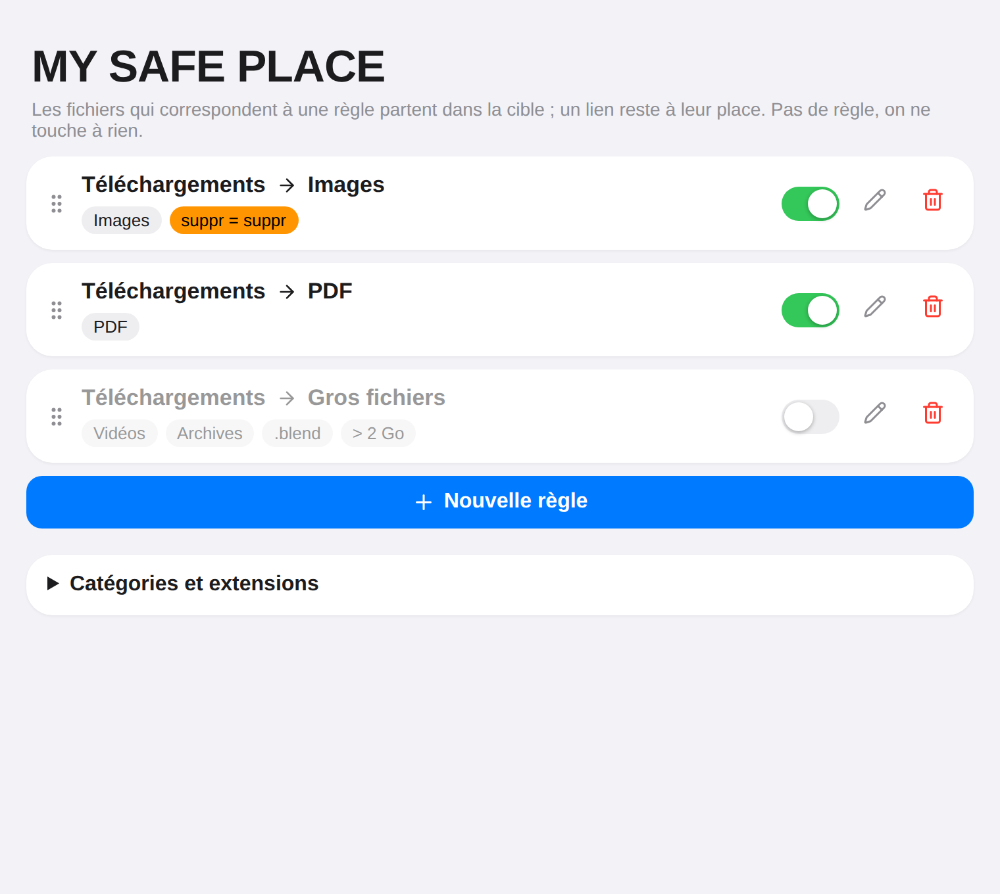
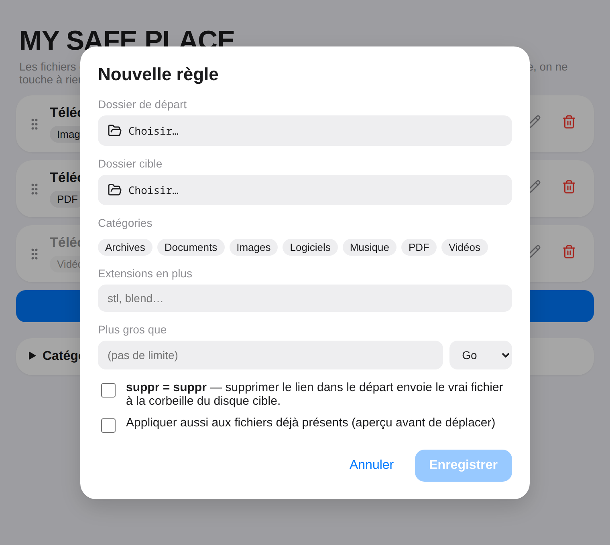
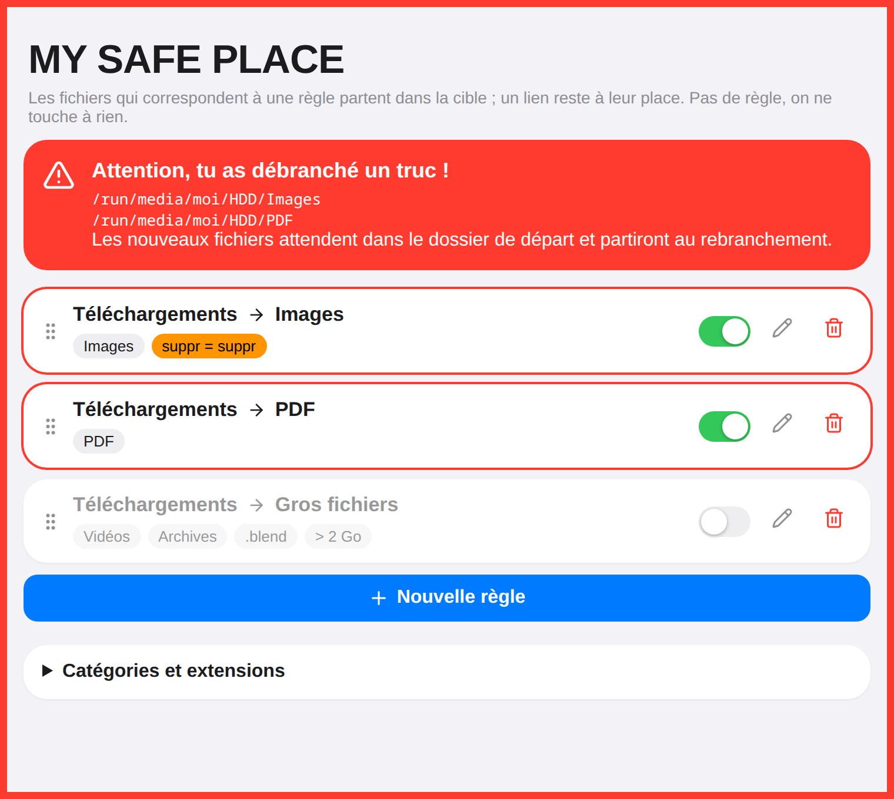
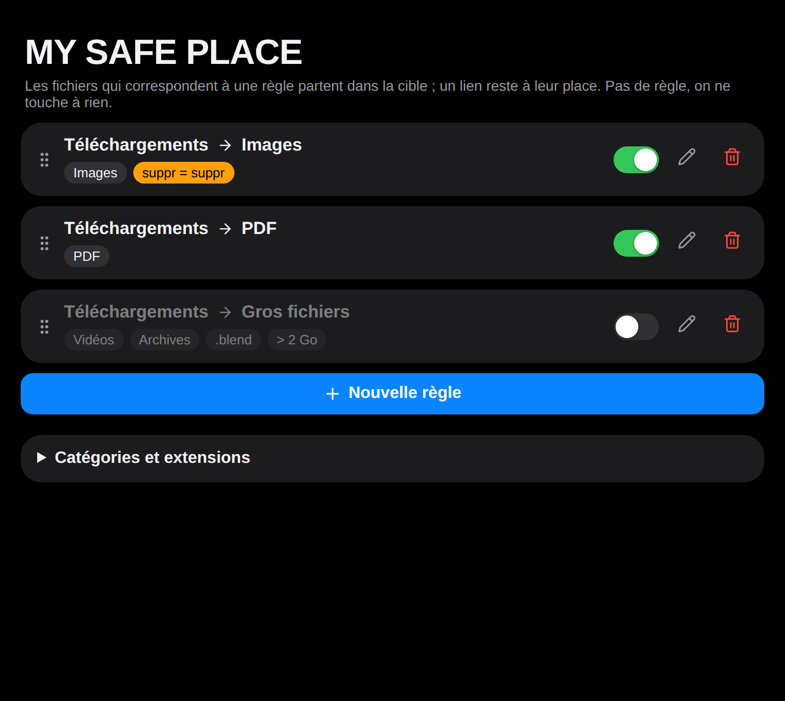

<div align="center">


# MY SAFE PLACE

**Range tes fichiers sur un autre disque, en laissant un lien à leur place.**

[](LICENSE)


</div>

---

Ton dossier `Téléchargements` est sur un petit SSD, tes photos et tes PDF
devraient vivre sur le gros disque dur ? MY SAFE PLACE s'en charge tout seul :
chaque fichier qui correspond à une règle part sur le disque cible, et un
**lien symbolique** reste à sa place. Tu le vois, tu l'ouvres, tu le
renommes comme avant — il ne prend juste plus de place sur le SSD.

**Pas de règle, on ne touche à rien.** L'appli fait comme si elle n'existait pas.

## À quoi ça ressemble

<table>
<tr>
<td width="50%" align="center"><br>Les règles, dans l'ordre où elles s'appliquent</td>
<td width="50%" align="center"><br>Une règle : départ, cible, filtres</td>
</tr>
<tr>
<td width="50%" align="center"><br>Disque débranché : tout clignote en rouge</td>
<td width="50%" align="center"><br>Thème sombre, suivi du système</td>
</tr>
</table>

## Ce que ça fait

- **Règles** : un dossier de départ, un dossier cible, et des filtres — par
  catégorie (Images, PDF, Vidéos, Musique, Archives, Documents, Logiciels ;
  extensions modifiables), par extension libre, par taille (« plus gros que 2 Go »).
  La première règle qui correspond gagne ; l'ordre se règle en glissant les cartes.
- **Rien ne se perd** : le fichier est copié, la copie est vérifiée octet par
  octet, et seulement ensuite l'original est remplacé par le lien. Les
  téléchargements en cours (`.part`, `.crdownload`…) sont ignorés jusqu'à ce
  que leur taille ne bouge plus.
- **Disque débranché** : la fenêtre, l'icône de la barre des tâches et une
  notification clignotent en rouge. Les nouveaux fichiers attendent dans le
  dossier de départ et partent au rebranchement. Le dossier cible n'est jamais
  recréé (sinon il finirait sur le SSD, sous `/run/media/…`).
- **suppr = suppr** (option par règle) : supprimer le lien envoie le vrai
  fichier à la corbeille du disque cible — récupérable.
- **Fichier supprimé dans la cible** : le lien devenu cassé est enlevé tout seul.
- **Fichiers déjà là** : à la création d'une règle, on peut l'appliquer aussi
  à l'existant, avec un aperçu pour choisir quoi déplacer.
- Tourne en arrière-plan, fenêtre fermée, et démarre avec la session.

## Installer

Linux uniquement (testé sur Bazzite / KDE Plasma).

1. Télécharge `MY-SAFE-PLACE.AppImage` depuis les [Releases](https://github.com/Gris-S/my-safe-place/releases).
2. `chmod +x MY-SAFE-PLACE.AppImage` puis lance-le.

Au premier lancement, l'appli s'ajoute au démarrage de la session
(`~/.config/autostart/my-safe-place.desktop`).

| Fichier | Contenu |
| --- | --- |
| `~/.config/my-safe-place/config.json` | Les règles et les catégories |
| `~/.local/share/my-safe-place/links.json` | Les liens créés (pour suivre suppressions et renommages) |

## Compiler

Il faut Node.js, Rust et les dépendances de [Tauri 2](https://v2.tauri.app/start/prerequisites/) pour Linux.

```sh
npm install
npx tauri dev                                   # lancer en développement
cd src-tauri && cargo test                      # tests du moteur
APPIMAGE_EXTRACT_AND_RUN=1 npx tauri build      # AppImage dans src-tauri/target/release/bundle
```

Le moteur est dans [`src-tauri/src/engine.rs`](src-tauri/src/engine.rs),
la fenêtre dans [`src/App.tsx`](src/App.tsx).

## Limites connues

- Le moteur regarde les dossiers toutes les 2 secondes (pas d'inotify).
- Seuls les fichiers à la racine du dossier de départ sont concernés, pas les sous-dossiers.
- Avec **suppr = suppr**, déplacer un lien vers un *autre* dossier compte comme
  une suppression : le vrai fichier part à la corbeille (récupérable).

## Licence

[GPL-3.0-or-later](LICENSE).
